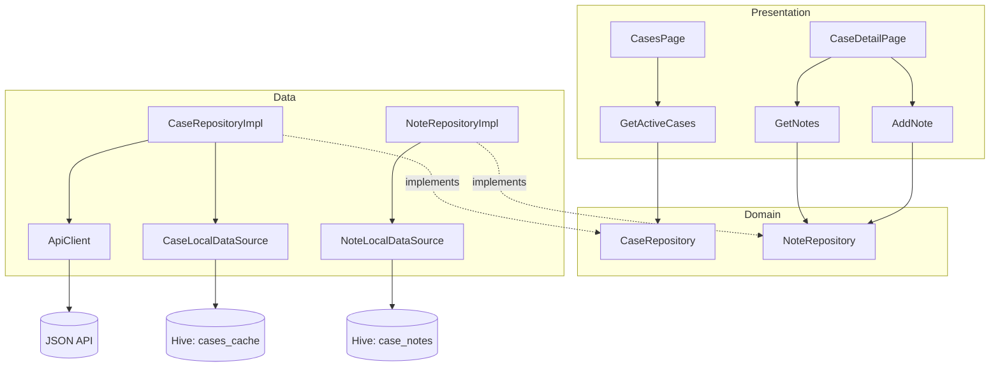

# Justice & Co. Case Tracker

A Flutter app for lawyers to browse their **active cases**, open a case to see
its details, and add **notes**. It keeps working when the office Wi-Fi drops.

## Features
- List of active cases fetched from an API (loading, success and error states).
- **Offline-first**: the last successful fetch is cached in Hive and shown when
  the API cannot be reached, with an "Offline" banner and the last sync time.
- **Case detail screen** (go_router): case ID, client ID, title and status.
- **Notes** per case, saved locally on the device and shown newest first.

## How to run
Requirements: Flutter 3.22 or newer (Dart 3.3+), an emulator or a phone.

```bash
flutter create .                          # once: generates android/ and ios/
flutter pub get
dart tool/add_internet_permission.dart    # once: adds INTERNET permission (needed for release)
flutter run
```

## Release build (Android)
```bash
flutter pub get
dart tool/add_internet_permission.dart    # safe to repeat, skips if already added
flutter build apk --release               # build/app/outputs/flutter-apk/app-release.apk
# or for the Play Store:  flutter build appbundle --release
```
Install the release APK on a real phone and repeat the manual test checklist
below. Release builds do not get the debug-only internet permission, which is
the usual reason an app works in debug but shows "No Internet Connection" in
release. The default template signs release builds with the debug key; create
a proper keystore before publishing to the Play Store.

### Manual test checklist
1. Open the app online: the list loads. Tap a case: the detail screen opens.
2. Type a note and press send: it appears at the top. Leave and re-open the case: it is still there.
3. Close the app, turn off Wi-Fi and data, re-open: the list shows with an Offline banner. Notes still work.
4. Uninstall, then open the app offline: the "No Internet Connection" screen appears with Retry.

## Architecture
Clean Architecture with three layers inside `lib/features/cases/`. Dependencies
point inward only: presentation -> domain <- data. The domain layer is plain
Dart and imports nothing from data or Flutter.



```
lib/
├── main.dart             composition root: Hive init, manual dependency injection
├── app_router.dart       go_router routes ('/' and '/cases/:id')
├── core/                 shared code: error/ (typed exceptions), network/ (ApiClient, NetworkInfo),
│                         theme/, utils/
└── features/cases/
    ├── domain/           entities (Case, Note, CasesResult), repository contracts, use cases
    ├── data/             models (JSON), remote data source (HTTP), local data sources (Hive),
    │                     repository implementations
    └── presentation/     pages (list, detail, not found) and widgets
```

**Data flow (cases):** `CasesPage` -> `GetActiveCases` -> `CaseRepositoryImpl`
-> `ApiClient` (HTTP) and `CaseLocalDataSource` (Hive).
**Data flow (notes):** `CaseDetailPage` -> `GetNotes` / `AddNote` ->
`NoteRepositoryImpl` -> `NoteLocalDataSource` (Hive).

**Error handling:** every failure is a typed exception (`NoInternetException`,
`ServerException`, `RequestTimeoutException`, ...). Nothing returns an empty
list to hide an error. The UI picks the icon and message from the exception type.

**Mock API:** `https://jsonplaceholder.typicode.com/todos`. `completed == true`
maps to a closed case, otherwise active. To use the real firm API, change the
URL in `case_remote_data_source.dart` and the mapping in `case_model.dart`.

## Offline-first sync strategy
`CaseRepositoryImpl.getActiveCases()`:
1. Try the API. On success, replace the Hive cache and return fresh data.
2. On any failure, return the cached data marked `fromCache = true`.
3. If there is no cache either, throw the original error.

## Trade-offs of the offline-first approach
- **Data can be stale.** Offline users see the last known state. The banner shows its age, but a case closed on the server stays "active" on the phone until the next successful sync.
- **Notes are local-only.** They are not sent to a server, are not shared between devices or lawyers, and are lost if the app is uninstalled or its data is cleared. A sync service is the next step.
- **No conflict resolution yet.** Once notes sync, concurrent edits will need a rule (for example last-write-wins or merging by timestamp).
- **Fetch-first means a wait on bad networks.** With Wi-Fi connected but no internet, the app waits up to 15 seconds (the API timeout) before showing cached data. A shorter timeout or showing the cache first and refreshing in the background would feel faster, at the cost of more complexity.
- **The whole list is cached and replaced each time.** Simple and consistent, but it will not scale to very large case lists without pagination or incremental sync.
- **Local data is not encrypted.** Hive stores plain text. For confidential legal notes, enable `HiveAesCipher` with a key kept in secure storage before real use.
- **Corrupted storage is wiped.** If a Hive file cannot be opened, the app deletes and recreates it so it can start. For the cases cache this is harmless (it re-downloads); for notes it means data loss.
- **Navigation passes the case object in memory (`extra`).** Simple, but a deep link or page restore to `/cases/5` shows "Case not found". Loading the case by ID from the cache would fix this.
- **Hive is in maintenance mode.** It is stable and simple; for new large projects, Drift or Isar-style alternatives are worth reviewing.

## Known limitations
- Android and iOS only (`ApiClient` uses `dart:io`; not for Flutter web).
- No automated tests are included yet.
- No login or user accounts; no editing or deleting of notes.
